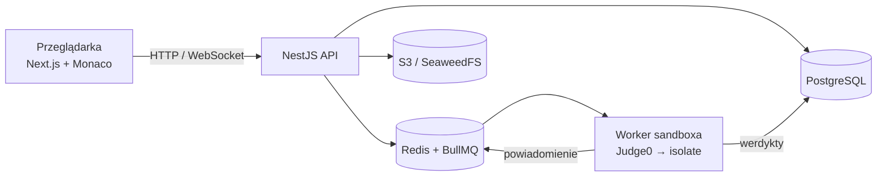

# CodePortal — projekt aplikacji do konkursów i testów z programowania

> 12 listopada 2026 · @mati90

## Koncepcja

CodePortal to „Testportal dla kodu”: organizator tworzy test lub konkurs, udostępnia link, uczestnicy piszą kod w przeglądarce, a system sam go uruchamia, punktuje i pilnuje uczciwości.

## Role

- **Organizator** (nauczyciel, firma, organizator konkursu) — tworzy zadania, testy, grupy, przegląda wyniki i raporty integralności.
- **Uczestnik** — wchodzi z linku (z kontem albo jako gość z imieniem/kodem dostępu), rozwiązuje w edytorze, dostaje wynik.
- **Admin platformy** — plany, limity, moderacja.

## Dwa tryby

| Tryb | Dla kogo | Cechy |
| --- | --- | --- |
| Test / sprawdzian | szkoła, rekrutacja | okno czasowe, jedna próba lub kilka, wynik po zakończeniu, ocena w skali szkolnej |
| Konkurs | koła, kluby, eventy | ranking na żywo, kary czasowe za błędne zgłoszenia, wiele zadań o rosnącej trudności |

## Strategia anty-AI

Uczciwe założenie: w 100% nie da się zablokować AI — uczestnik może mieć telefon obok. Cel to sprawić, że korzystanie z AI jest **trudne, wykrywalne i nieopłacalne**, przy zachowaniu pełnego komfortu IDE (podświetlanie, podpowiedzi, formatowanie, uruchamianie). Ostateczną decyzję o nieuczciwości zawsze podejmuje człowiek na podstawie raportu, nie automat.

Ochrona działa w czterech warstwach: żadna nie wystarcza sama, razem robią z oszukiwania drogę przez mękę z dużą szansą wpadki.

### Warstwa 1 — środowisko bez AI (prewencja)

- Edytor ma tylko „głupie” podpowiedzi: słowa kluczowe, snippety, symbole z kodu, sygnatury z biblioteki standardowej. Zero inline completion generującego linie kodu.
- Wklejanie z zewnątrz zablokowane (przechwycenie `paste`, `drop`, `beforeinput` z `insertFromPaste`). Kopiuj-wklej wewnątrz edytora działa — schowek wewnętrzny, nie systemowy.
- Tryb pełnoekranowy wymuszany przy starcie; wyjście = zdarzenie w logu + ostrzeżenie na ekranie.
- Treść zadania renderowana jako obraz/canvas lub z niewidzialnymi znakami-pułapkami, żeby nie dało się jej po prostu skopiować do czatu.
- Opcjonalnie dla egzaminów: tryb „Safe Exam Browser” (aplikacja SEB lub własna lekka aplikacja Electron/Tauri w kiosku) — blokuje inne okna i rozszerzenia przeglądarki.

### Warstwa 2 — telemetria zachowania (wykrywanie na żywo)

- Zapis każdej zmiany w edytorze (delta Monaco + znacznik czasu) — pełny „replay” pisania.
- Zdarzenia: utrata fokusu (`blur`, `visibilitychange`), wyjście z fullscreen, próby wklejenia, zmiana rozmiaru okna, otwarcie DevTools (heurystyki).
- Metryki: tempo pisania, długie pauzy zakończone nagłym wybuchem dużego, poprawnego bloku kodu, brak typowych poprawek/literówek.
- Opcjonalnie: kamerka (zdjęcie co N sekund) — tylko z jawną zgodą i informacją RODO.

### Warstwa 3 — analiza po fakcie (dowód)

- Wskaźnik ryzyka 0–100 na zgłoszenie, liczony z warstwy 2 (wagi konfigurowalne).
- Odtwarzacz sesji dla organizatora — widzi, jak kod powstawał, z osią czasu i zaznaczonymi zdarzeniami podejrzanymi.
- Podobieństwo między uczestnikami — porównanie tokenów/AST (w stylu MOSS/JPlag), wykrywa ściąganie od siebie.
- Porównanie z „wzorcami AI” — organizator może wcześniej wygenerować rozwiązania AI dla swoich zadań; system liczy podobieństwo do nich. To sygnał, nie wyrok.

### Warstwa 4 — zadania odporne na AI (projekt)

- Parametryzacja: każdy uczestnik dostaje inne dane wejściowe/warianty zadania (losowane z puli).
- Krótki limit czasu na zadanie, sekwencyjne odblokowywanie zadań, brak powrotu.
- Pytania o własny kod: po zgłoszeniu losowe pytanie „co robi linia 14?” lub „zmień X tak, żeby…” w 2 minuty — bardzo skuteczne przeciw osobie, która kodu nie napisała.
- Zadania typu „napraw błąd w tym kodzie” lub „uzupełnij lukę” — trudniej je przepisać do czatu niż treść zadania.

### Poziomy ochrony

Organizator wybiera poziom ochrony przy tworzeniu testu:

| Poziom | Zakres |
| --- | --- |
| **Luźny** | tylko telemetria |
| **Standard** | blokada wklejania + fullscreen + raport |
| **Egzamin** | SEB/kiosk, kamerka, pytania o kod |

## Edytor w przeglądarce

Podstawą jest **Monaco Editor** (silnik VS Code) — daje podświetlanie, multi-kursor, skróty i minimapę „za darmo”, a nie ma wbudowanego AI.

| Funkcja IDE | Jak zrealizować | AI? |
| --- | --- | --- |
| Kolorowanie składni | Monaco (Monarch) dla HTML, CSS, JavaScript, Python, Java, C#, C++, PHP | nie |
| Podpowiedzi (IntelliSense) | HTML, CSS i JS mają je wbudowane w Monaco; pozostałe przez serwery języka: Pyright, clangd, jdtls, OmniSharp, Intelephense (`monaco-languageclient` + WebSocket) | nie |
| Błędy na bieżąco | diagnostyka z LSP (czerwone podkreślenia) | nie |
| Formatowanie | Prettier (HTML/CSS/JS), black/ruff, clang-format, google-java-format, CSharpier, php-cs-fixer — skrót `Shift+Alt+F` | nie |
| Snippety | własne, włączane/wyłączane przez organizatora | nie |
| Uruchomienie z własnym wejściem | przycisk „Uruchom” → sandbox, wynik w konsoli | nie |
| Podgląd strony | zadania webowe: podgląd na żywo w `iframe` z `sandbox` (HTML/CSS/JS w przeglądarce, PHP renderowany w sandboxie) | nie |
| Testy przykładowe | przycisk „Sprawdź na przykładach” (jawne testy) | nie |

### Uwagi wdrożeniowe

- LSP odpalaj w osobnych kontenerach (po jednym na sesję lub pula), z limitem pamięci.
- Języki: **HTML, CSS, JavaScript, Python, Java, C#, C++, PHP** oraz zadania łączące kilka z nich (np. HTML + CSS + PHP).
- Tańsza alternatywa na MVP: same podpowiedzi Monaco (słowa z dokumentu + snippety + lista funkcji biblioteki standardowej w JSON) bez LSP.
- Organizator może wyłączyć wybrane funkcje (np. bez podpowiedzi na sprawdzianie ze składni).
- Autozapis wersji co kilka sekund do backendu — awaria przeglądarki nie kasuje pracy.
- Ciemny/jasny motyw, rozmiar czcionki, układ: zadanie po lewej, edytor po prawej, konsola na dole.

### Zadania łączone (webowe)

Zadanie może mieć kilka plików w różnych językach, np. `index.html` + `style.css` + `script.js` albo `index.php` + `style.css`.

- Organizator wybiera zestaw języków i pliki startowe; uczestnik widzi zakładki plików w edytorze.
- HTML/CSS/JS uruchamiają się w przeglądarce uczestnika w izolowanym `iframe` (`sandbox`, bez dostępu do strony testu); PHP renderuje worker sandboxa i zwraca HTML do podglądu.
- Ocenianie nie porównuje wyjścia z wejściem, tylko sprawdza wynikową stronę: worker otwiera ją w przeglądarce headless (Playwright) i odpala testy organizatora — istnienie elementów (selektory), tekst, atrybuty, obliczone style, reakcję na kliknięcie / wysłanie formularza (PHP). Każdy test to punkty i werdykt `OK`/`WA`/`RE`, jak w zadaniach klasycznych.
- Do tego ręczna rubryka nauczyciela (wygląd, semantyka), bo nie wszystko da się sprawdzić automatem.

## Przepływy użytkownika

### Organizator — tworzenie testu

1. **Tworzy zadania w banku zadań** (można je reużywać):
   - treść w Markdown + LaTeX, języki dozwolone, szablon startowy kodu,
   - testy: jawne (przykłady) i ukryte, limity czasu/pamięci, punkty za każdy test,
   - opcjonalnie: rozwiązanie wzorcowe (walidacja testów), warianty/parametry, własny checker.
2. **Składa test/konkurs**: wybiera zadania (lub losowanie N z puli), kolejność, czas, okno dostępności, liczbę prób, poziom ochrony, skalę ocen.
3. **Ustawia dostęp**: link publiczny, link + hasło, kod dostępu, lista uczestników (import CSV / klasa), lub logowanie kontem szkoły (Google/Microsoft).
4. **Publikuje** → dostaje link `codeportal.pl/t/AB12CD` i kod QR do rzutnika.
5. **W trakcie**: panel na żywo — kto jest w teście, postęp, alerty (wyjście z fullscreen, próby wklejenia), możliwość dodania czasu lub zakończenia sesji.
6. **Po teście**: wyniki, raport integralności, odtwarzacz sesji, ręczna korekta punktów, eksport CSV/XLSX (do dziennika).

### Uczestnik — rozwiązywanie

1. Otwiera link → podaje imię/nazwisko lub loguje się → widzi regulamin i zasady ochrony (zgoda).
2. Test sprzętu: fullscreen, ewentualnie kamera → start, rusza licznik czasu (liczony na serwerze, nie w przeglądarce).
3. Pisze kod, uruchamia na własnych danych i przykładach dowolnie wiele razy.
4. Klika **Zgłoś** → kod trafia do kolejki oceniania → wynik (od razu lub po zakończeniu — decyduje organizator).
5. Po czasie sesja zamyka się automatycznie; ostatnia wersja kodu jest zgłaszana sama.

> **Połączenie zerwane?** Praca jest zapisana na serwerze, uczestnik wraca tym samym linkiem i kontynuuje (czas nadal płynie, zdarzenie trafia do logu).

## System oceniania

Ocena jest automatyczna (testy w sandboxie) z opcjonalną ręczną korektą i dodatkowymi kryteriami jakości kodu.

### Silnik oceniający (judge)

- Każde zgłoszenie: kompilacja → uruchomienie na każdym teście w izolacji → porównanie wyjścia → werdykt.
- Izolacja: `isolate` (sandbox z olimpiad, cgroups) albo gotowy Judge0 self-hosted na start. Bez sieci, limit CPU, RAM, procesów, rozmiaru wyjścia.
- Werdykty: `OK`, `WA` (zła odpowiedź), `TLE` (przekroczony czas), `MLE` (pamięć), `RE` (błąd wykonania), `CE` (błąd kompilacji).
- Porównywanie: dokładne, ignorujące białe znaki, liczby z tolerancją (ε), lub własny checker (gdy poprawnych odpowiedzi jest wiele).
- Typy zadań poza klasycznym wejście/wyjście: testy jednostkowe (uczestnik pisze funkcję, system odpala pytest/JUnit/Jest/xUnit/PHPUnit) — wygodniejsze w szkole; zadania webowe (testy strony w Playwright, patrz „Zadania łączone”).

### Punktacja

| Element | Opcje |
| --- | --- |
| Punkty za zadanie | suma za zaliczone testy lub grupy testów (subtaski: grupa liczy się tylko w całości) |
| Które zgłoszenie liczy się | najlepsze lub ostatnie |
| Kary (konkurs) | styl ICPC: liczba zadań, potem czas + 20 min za każde błędne zgłoszenie; albo styl IOI: suma punktów |
| Jakość kodu (opcjonalnie) | linter (ruff, clang-tidy), złożoność, zakazane konstrukcje (np. `sort()` gdy zadanie każe napisać sortowanie) |
| Ręczna ocena | rubryka nauczyciela (czytelność, komentarze) + korekta punktów z uzasadnieniem |
| Ocena szkolna | próg procentowy → ocena 1–6, konfigurowalny per szkoła |

### Ranking i wyniki

- **Konkurs**: tablica wyników na żywo (WebSocket), opcjonalnie „zamrożenie” na ostatnie 30 min.
- **Test**: uczestnik widzi wynik od razu, po zakończeniu testu albo dopiero po zatwierdzeniu przez nauczyciela.
- **Raport dla organizatora**: wynik + wskaźnik ryzyka + odtwarzacz + podobieństwa obok siebie, z przyciskiem „oznacz jako niesamodzielne” (zeruje lub obniża wynik).

## Architektura techniczna

Stack: Next.js, NestJS, PostgreSQL, Redis, Docker na VPS. **Kluczowa zasada: kod uczestnika nigdy nie wykonuje się w procesie API.**

API tylko przyjmuje zgłoszenia i wrzuca je do kolejki; workery sandboxa pobierają je, uruchamiają i zapisują werdykty, a wynik wraca do przeglądarki przez WebSocket.

**Bezpieczeństwo**: testy ukryte nigdy nie trafiają do przeglądarki; czas testu liczony wyłącznie na serwerze; uczestnik dostaje krótkotrwały token sesji powiązany z egzaminem; rate limit na uruchomienia (np. 1 na 3 s).

| Warstwa | Technologia | Uwagi |
| --- | --- | --- |
| Frontend | Next.js (App Router), Tailwind, Monaco, monaco-languageclient | panel organizatora + widok testu w jednej aplikacji |
| Backend | NestJS, Drizzle ORM, Socket.IO | moduły: auth, problems, exams, sessions, submissions, integrity |
| Kolejka | Redis + BullMQ | osobne kolejki: `judge`, `similarity`, `export` |
| Sandbox | Judge0 (MVP) → własny worker na isolate | worker na osobnej maszynie/VPS, bez dostępu do sieci i bazy poza wynikami |
| Baza | PostgreSQL | `editor_events` partycjonowane po dniu |
| Pliki | S3 (SeaweedFS) | duże testy, zdjęcia z kamerki |
| Deploy | Docker Compose na Ubuntu VPS, Caddy/Traefik z HTTPS | później workery skalowane osobno |

## Model danych

Rdzeń to 14 tabel w PostgreSQL; zdarzenia telemetrii idą do osobnej, partycjonowanej tabeli, bo będzie ich najwięcej.

| Tabela | Najważniejsze pola |
| --- | --- |
| `users` | id, email, name, role (organizer/participant/admin), org_id |
| `organizations` | id, name, type (szkoła/firma), plan, grading_scale (JSON) |
| `problems` | id, owner_id, title, statement_md, languages[], starter_code (JSON, pliki startowe), time_limit_ms, memory_limit_mb, type (io/unit/web), checker_type, checker_code, variants (JSON) |
| `test_cases` | id, problem_id, group_no, input, expected_output, points, is_sample, script (dla `web`: test strony w Playwright zamiast input/expected) |
| `exams` | id, owner_id, mode (test/contest), slug, starts_at, ends_at, duration_min, attempts, protection_level, results_visibility, scoring_rule, settings (JSON) |
| `exam_problems` | exam_id, problem_id, order, points_override, pool_tag |
| `exam_access` | exam_id, type (link/password/list/sso), secret_hash, allowed_emails[] |
| `sessions` | id, exam_id, user_id lub guest_name, started_at, deadline_at, finished_at, ip, user_agent, risk_score, status |
| `code_snapshots` | id, session_id, problem_id, language, files (JSON: lista `{path, content}`, jeden plik w zadaniach jednojęzycznych), created_at (autozapis) |
| `editor_events` | id, session_id, ts, type (delta/paste_blocked/blur/fullscreen_exit/run), payload (JSONB) — partycje po dacie |
| `submissions` | id, session_id, problem_id, language, files (JSON), status, verdict, score, time_ms, memory_kb, submitted_at |
| `submission_results` | submission_id, test_case_id, verdict, time_ms, memory_kb, output_excerpt |
| `reviews` | submission_id, reviewer_id, manual_score, rubric (JSON), flagged_dishonest, comment |
| `similarity_pairs` | exam_id, problem_id, submission_a, submission_b, score, method |

Duże rzeczy (testy powyżej ~1 MB, nagrania z kamerki) trzymaj w S3 (SeaweedFS), w bazie tylko klucze.

## Roadmapa

MVP da się zbudować w ok. 6–8 tygodni w pojedynkę, jeśli ocenianie oprze się na gotowym Judge0, a podpowiedzi na samym Monaco bez LSP.

### Etap 1 — MVP (działający sprawdzian w klasie)

- [ ] Konta organizatorów, wejście uczestnika z linku jako gość
- [ ] Bank zadań: treść MD, testy jawne/ukryte, limity
- [ ] Edytor Monaco: HTML, CSS, JS, Python, Java, C#, C++, PHP — kolory, podstawowe podpowiedzi, formatowanie
- [ ] Judge0 self-hosted + kolejka BullMQ, werdykty i punkty (Python, Java, C#, C++, JS, PHP)
- [ ] Zadania łączone (np. HTML + CSS + PHP): wiele plików, podgląd na żywo, ocena ręczna
- [ ] Blokada wklejania, fullscreen, log zdarzeń (blur, paste)
- [ ] Wyniki + eksport CSV

### Etap 2 — Uczciwość i szkoły

- [ ] Pełny zapis delt + odtwarzacz sesji
- [ ] Wskaźnik ryzyka i panel na żywo dla nauczyciela
- [ ] Podobieństwo między zgłoszeniami (tokeny/AST)
- [ ] Zadania z testami jednostkowymi, ocena 1–6, ręczna rubryka
- [ ] Automatyczne testy zadań webowych (Playwright w workerze)
- [ ] Logowanie Google/Microsoft (konta szkolne), klasy/grupy

### Etap 3 — Konkursy i skala

- [ ] Tryb konkursu: ranking na żywo, ICPC/IOI, subtaski, własne checkery
- [ ] LSP (Pyright, clangd, jdtls, OmniSharp, Intelephense) w kontenerach
- [ ] Własny sandbox na isolate zamiast Judge0, autoskalowanie workerów
- [ ] Warianty zadań, pytania o własny kod po zgłoszeniu, porównanie z rozwiązaniami AI
- [ ] Tryb Egzamin: aplikacja kiosk (Tauri) lub integracja z Safe Exam Browser
- [ ] Plany płatne dla szkół i firm

## Kwestie prawne

Do załatwienia przed startem: RODO (zgoda na telemetrię, szczególnie gdy uczestnicy są niepełnoletni — zgoda rodziców/szkoły), polityka retencji nagrań i logów, regulamin, umowa powierzenia danych ze szkołami.
